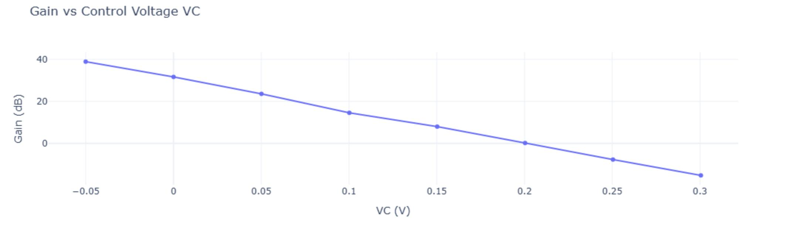
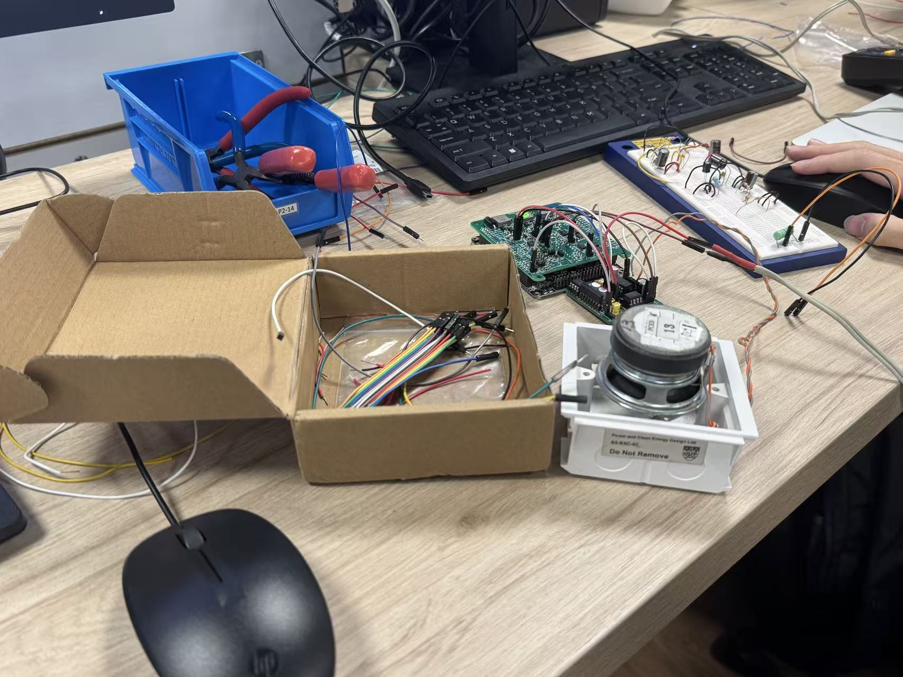

# Automatic Volume Control for an Audio Amplifier

EE2073 course laboratory | AY2025/26 Semester 2

This course laboratory project combined a voltage-controlled amplifier (VCA), power amplifier and volume-unit (VU) meter into an adjustable audio amplifier. A microcontroller and Python-based computer interface supported signal generation, acquisition and parameter adjustment. My EE2073 report records the subsystem measurements, integration checks and problems encountered during testing.

The VCA was characterized by varying its control voltage and comparing input and output peak-to-peak amplitudes. Gain was calculated as 20 log10(Vout/Vin). The measurements showed that reducing the control voltage increased gain; large signals at high gain could clip when the amplifier reached its supply limits. The power amplifier was tested from 100 Hz to 50 kHz with 0.1 V and 0.2 V peak inputs, revealing differences in measured gain and high-frequency behaviour.

The VU-meter tests followed the signal through amplification, diode rectification and smoothing. Its final DC-like output tracked signal level, while very small inputs gave a weaker response because of the diodes. During integration, the audio output and VU-meter reading were checked together as input level and control voltage changed.

One useful debugging case was an incorrectly connected negative supply, which damaged an OP275 op-amp. The report describes checking the circuit step by step, correcting the connection and replacing the component before testing again. This reinforced the importance of checking power rails and each subsystem before judging the complete system.

Original EE2073 report, Figure 2.4.3, p. 18.

Original report, Figure 4, p. 19.

## Scope and source

The figures below come from the original report. They document laboratory integration and gain-control measurements, not a new experiment. This summary does not claim a quantified closed-loop regulation response or a standalone software release. The course project was performed in a group; this note is based on my individual report. Source: my individual *EE2073 Project Report: Automatic Volume Control for Audio Amplifier System*, AY2025/26 Semester 2, sections 2.1-2.4. The original cover and student identifiers are not republished.
