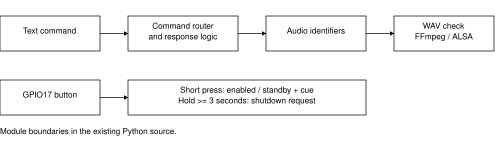

# Voice-Interactive Companion Robot

Ongoing student project | July 2026 - Present | ENGenious Sparks Grant 2026

I am developing a small companion robot as a year-long student project supported by the ENGenious Sparks Grant 2026. The aim is to connect understandable interactions with modular software, so input handling, responses and physical controls can be developed separately.

## Existing software modules

The current Python modules separate text-command routing, response selection and audio playback. The router handles functions such as time, date, greetings and fallback responses. Functions return audio identifiers; the speaker module checks for the corresponding WAV files, combines available clips with FFmpeg and plays them through ALSA. This separation helps distinguish a missing audio file from a routing problem.

A Raspberry Pi GPIO17 button module provides a physical control. A short press toggles the enabled/standby state and selects an audio cue. A hold of at least three seconds requests the shutdown sequence. These behaviours are represented in the existing source code.

## Motion and belief design

The motion notes describe parameters for eyes, eyelids, mouth, head and limbs, including timing and return-to-neutral behaviour. Speech-driven mouth movement is separated from expression offsets. These are actuator-integration design targets, rather than measured motion results.

My separate belief-revision notes explore object identity, last observation time, location and uncertainty as a basis for object memory. This remains design work in the available materials. The next step is to connect the interaction modules to hardware and trace one input through response selection, audio playback and movement, recording failures and timing.

## Scope and materials

This note is based on the existing `dialogue.py`, `speaker.py`, `button.py` and `date_time.py` modules, motion-template notes and a conceptual belief-revision notebook. It describes source structure and design progress; it is not a hardware test report or proof of integrated speech, vision and servo behaviour. Personal recordings, photographs, dialogue content and service credentials are omitted.
